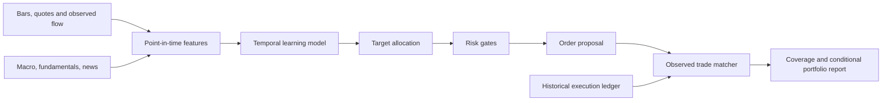

# Architecture

StockTrade separates data collection, information alignment, representation learning, allocation, risk checks, and execution evidence. The default is a long-only, single-symbol research workflow for US equities in USD. A portfolio across many stocks is a separate extension: one-symbol results do not account for correlated positions or portfolio-wide liquidity.

## Data and temporal boundaries

Every completed bar has a timezone-aware end timestamp. Its open, high, low, close and volume become eligible at that end, not at the start. Information events retain `published_at` and `available_at`; a feature can use the event only after both timestamps. Delayed delivery remains delayed in a historical replay.

Feature construction preserves observation masks. Missing bid/ask or absent fundamentals are not equivalent to true zero values. Unknown publication or availability dates do not satisfy the event contract. Feature scaling is fitted on the training period and reused for evaluation. An evaluation run must preserve the checkpoint's feature names and order.

The workflow derives feature names only from information known in the training prefix. Evaluation freezes that schema: future-only keys are ignored, and absent expected fields remain masked. New sources require retraining before their features can influence a decision.

`model.info.json` hashes the point-in-time training/validation feature and price prefix. Evaluation requires this sidecar beside the checkpoint and rejects altered history or incompatible schemas. The default split is 70% training, 15% validation and 15% held-out rows. Evaluation starts with the final validation bar's decision for the first held-out return and continues forward. It can use appended future bars when the original prefix remains unchanged.

Separate adapters should map providers into these normalized records. A provider's daily fundamentals table or adjusted historical prices cannot automatically be considered point-in-time data. That adapter needs explicit revision, release, corporate action and availability rules.

## Representation and allocation

Up to five modality groups pass through small MLP encoders and a causal GRU; empty groups are omitted. Masked reconstruction and Gaussian prediction of the next feature vector learn from observations without buy/sell labels. Training uses complete history windows and mean/std scaling fitted on the observed training features. Features never observed during training remain masked at inference until retraining. The best validation prediction checkpoint retains the model configuration, scaler and feature order.

The trading policy maps its learned representation to a bounded capital fraction. A sigmoid allocation head learns from detached predicted return distributions with expected return, variance, lower-tail risk, approximate turnover and cost terms. The Gaussian log-return forecast supplies a next-interval return mean, volatility and lower-tail estimate. These distribution assumptions need calibration. Details of the research implications are described in [research methodology](research.md).

Temporal causality restricts attention to current and prior observations. This is a protection against look-ahead in model inputs. It is not economic causal identification and does not show that a news item, rate change, or order caused a price move.

The initial text representation is a deterministic fixed-width feature transformation. It is a practical ingestion baseline, not a pretrained semantic news model. A learned language encoder, entity resolution and deduplication need separate validation before they are treated as information advantages.

## Risk and sizing

The policy proposes an allocation fraction. Capital, executable quotes and existing holdings determine a quantity, subject to long-only cash constraints and risk gates. Buys use the known ask and sells use the known bid. Sizing adjusts exposure and cash-reserve caps for spread, fees and estimated slippage effects on resulting equity, then quantizes to whole shares by default. The gates remain outside the neural model: a learned policy cannot relax a hard exposure limit by changing its parameters.

Default gates cap single-symbol exposure at 20% of equity and gross exposure at 60%, retain 20% cash, limit participation to 1% of observed interval volume, and limit equity turnover per proposal to 10%. A 15% peak drawdown or 3% daily loss requests a risk-reducing sale when liquidity permits. Missing or nonfinite inputs, insufficient confidence, and spreads above 50 basis points block unsuitable proposals. Per-interval volatility and lower-tail portfolio budgets default to 1% and 2%.

The confidence gate uses a heuristic combining observation coverage and predicted uncertainty; it is not calibrated prediction accuracy. These are configurable research defaults, not calibrated recommendations. A prediction interval of one second and an interval of one minute require different interpretation and calibration. The controls do not cover every risk, including broker failure, exchange outages, corporate action errors, event discontinuities, correlated portfolio positions or liquidation during a halt.

## Execution evidence

Execution evaluation operates after a decision. It searches a bounded time window for recorded trades compatible with the symbol, execution mode, limit price, quantity and market regime. Aggressive proposals require the same aggressor side and supporting pre-event quotes. Passive proposals require the opposite aggressor side and vendor-supported queue progression. It selects the earliest compatible event, without ranking later profit. Records must not be reused to justify multiple distinct analogs.

When compatible records are absent, the evaluator abstains instead of filling at a bar price. An unmatched proposal must remain visible in the report. Coverage, match distance and the scale of the proposed order relative to recorded liquidity matter as much as a conditional return. The CLI requires the recorded quantity to match exactly. The standalone execution API can allow a smaller near-size analog and retains its actual quantity. The replay avoids overlapping analog observation windows so future matching outcomes cannot affect earlier decisions.

The portfolio ledger remains hypothetical: historical trades are evidence for plausible executions. Matching does not identify where a new order would sit in the queue, which counterparties it would displace, or how others would respond. True queue analysis requires full depth event sequences, order identifiers, venue rules, clock synchronization and a causal or structural impact model.

## Extension boundaries

Add new information sources through event adapters without changing the time contract. Add new model architectures behind the feature and checkpoint contract. Add risk policies before the matcher. Extend execution adapters only when their source identifies the semantics of sides, quantities, venue and timestamps.

There is no live broker connection. Production order submission, operational monitoring, kill switches, reconciliation and execution permissions are outside the implemented research workflow.
