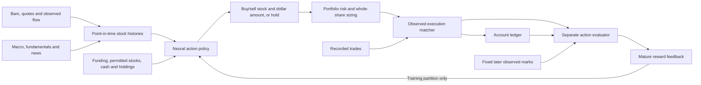

# Architecture

StockTrade separates point-in-time input preparation, direct action selection, portfolio constraints, observed execution evidence and delayed feedback. The workflow is long-only and supports a permitted universe of US equities in USD. One decision proposes hold or one dollar-valued buy/sell action; a series of decisions can build positions across stocks.

## Data and temporal boundaries

Every bar timestamp is its timezone-aware end. OHLCV becomes eligible at that end. Information events retain `published_at` and `available_at`; both must have passed before use. Delayed delivery remains delayed during replay. Stock histories use exactly matching decision timestamps. Missing timestamps are rejected rather than silently padded or filled from the future.

Feature construction preserves observation masks. Missing quotes or fundamentals are not true zero values. Feature names and scaling statistics come only from the training prefix. Validation and evaluation freeze the schema and scaler; future-only numerical keys are ignored until retraining, and features never observed in training remain masked.

The policy's lookback defaults to 16 completed bars for each stock. Minute and second input produce different elapsed lookbacks and reward periods, even with the same step counts. Causal sequence processing means a decision sees current/past observations only; it does not establish economic causal relationships.

The chronological default split is 70% training, 15% validation and 15% held-out decision timestamps. Training uses bounded 128-bar chunks by default, resets the funded account for each chunk, and updates weights only after its complete rollout. Validation/evaluation each use a fresh account across their respective partition. Supported executions and the complete reward horizon must remain within the same partition/chunk. Its final horizon bars are reserved for feedback observation, with no new actions. The lower-level evaluator labels a truncated horizon immature instead of shortening it.

`model.info.json` retains checkpoint provenance beside `model.pt`; evaluation checks the original feature/price prefix before using later observations. The stock universe and preprocessing are part of the checkpoint contract. At inference the allowed symbols may restrict the trained universe; adding a new stock requires retraining. Held stocks outside that permitted subset still need observed marks and contribute to account context. Positive holdings outside the trained universe are rejected. Earlier forecast-based checkpoints require retraining; the new format is a direct-action policy.

Provider adapters must preserve release, revision, corporate action and delivery-time semantics. A current fundamentals table or revised historical price series is not automatically point-in-time input.

## Direct neural policy

For each stock, small modality encoders process values together with their observation masks. A shared GRU compresses the historical sequence. Inventory features and an account embedding condition the representation on current cash, funding, holdings and loss state. Cross-stock attention lets the policy compare the allowed stocks rather than allocating from an isolated single-stock forecast.

The action head supplies categorical probabilities for:

- A single hold action.
- A buy or sell for each allowed stock, at each configured dollar-budget bin.

The default bins are 1%, 5%, 10% and 20% of initial funding. Action amounts are proposal budgets, not holdings targets. The output is a trading intention such as “buy NVDA for up to $1,000”; it is not a predicted price, return distribution or supervised buy/sell label. There are no price prediction or reconstruction heads and no loss computed against predicted market outcomes.

During training, actions are sampled for exploration. A REINFORCE policy-gradient objective adjusts each action's likelihood from its own mature evaluator feedback, relative to a running empirical baseline from prior updates. Entropy regularization encourages exploration, and gradient clipping limits unstable updates. The modality encoders, GRU, attention, account representation and action head train together from this feedback. There is no learned value/forecast head.

Each decision receives one delayed comparison of its subsequent account path with its own frozen pre-decision cash/holdings baseline. Later supported purchases and sales affect that account path, but their separately computed action rewards are never added to the earlier feedback. Doing so could reward a poor acquisition merely because a later sale avoided more losses. A hold can receive feedback for subsequent supported portfolio choices, including waiting before a later purchase; when the account continues unchanged its feedback is zero. Future marks enter the separate evaluator after maturity and never enter the policy's observation window.

Checkpoint selection uses the validation ledger's actual recorded-execution account return minus a drawdown penalty, default `ledger_return − 0.5 × max_drawdown`. The coefficient is configured by `--selection-drawdown-weight`. Raw shaped-feedback sums remain diagnostic values, not the selection objective. Validation uses frozen weights; test observations never update the policy or select its checkpoint.

News currently uses deterministic hashed tokens, activity and age. This is not a pretrained semantic language model or evidence of reliable sentiment identification.

## Risk and sizing

The risk layer sees the proposed action, observed quotes and the whole account. Existing positions contribute to equity and gross exposure. Sells are bounded by owned shares, so the policy cannot open a short position. Buys must fit available cash and the reserve after estimated costs. Buys budget against the ask and sells against the bid before rounding down to whole-share lots.

Default controls cap a stock at 20% of equity, gross exposure at 60%, interval participation at 1% of observed volume and proposal turnover at 10% of equity, while retaining 20% cash. Poor data coverage or spreads above 50 basis points can block a proposal. A 15% peak drawdown or 3% daily loss blocks additional buys while permitting risk-reducing sales subject to execution evidence. It does not replace a chosen hold with a forced sale.

The amount after risk sizing can be smaller than the proposed amount. A budget below one share's price yields no order. These deterministic gates are distinct from learned reward shaping; the neural policy cannot relax them. An explicit constraint cost, controlled by `--constraint-penalty`, may train the policy away from violating hard controls. This cost is reported separately and is not an economic loss from a fabricated execution.

The risk layer has no forecast dependency. Avoided downside enters delayed feedback through observed paths. These controls do not cover every risk, including exchange halts, correlated tail events, provider errors, operational outages or forced liquidation without liquidity.

## Separate portfolio evaluator

The active trainer calls `evaluate_portfolio_action`. Each pending decision stores a copy of its pre-decision cash and holdings. At each later observed timestamp, the baseline equity is `cash_before + sum(shares_before × observed_price)`. Shares and cash remain unchanged in this baseline. All held stocks receive current observed marks, including stocks outside a restricted runtime trading subset.

The other path is the account ledger: the proposed action and later actions change cash/holdings only when recorded execution evidence supports them. The evaluator combines weighted future equity differences with `0.25 × (baseline downside − ledger downside)` by default. Each downside is the largest dollar loss below pre-decision equity inside the fixed horizon: `max(0, equity_before − minimum future equity)`. This differs from the peak-to-trough percentage drawdown used for checkpoint selection. The comparison measures a decision and its observed portfolio continuation rather than isolating the causal contribution of one order. No alternative buy, sale or exit price is invented.

At an eight-bar horizon, checkpoint weights default to 25% at bar 1, 25% at bar 4 and 50% at bar 8. The pipeline's one-basis-point execution fee is already included in the account ledger and is not deducted again by the portfolio evaluator. Spread and price slippage already enter recorded execution prices. Feedback is divided by initial funding, so small orders do not earn the same economic weight as large ones merely through normalization.

The reward requires all eight future observations. Future prices value both paths; they are never assumed executable exits. Each full-universe account snapshot is recorded before that bar's new action, after previous supported executions. Pending feedback cannot use timestamps later than the point replay has reached. Its evidence IDs include supported executions from the decision and subsequent account changes through maturity. Weights, horizons, costs and downside coefficients must be fixed before validation/test. The evaluator never selects a favorable endpoint after observing the outcome.

Consider one share bought at $100 and subsequently sold through a supported execution at $95 before a decline to $10. The purchase's actual continuation retains $95 cash, so its loss against keeping the original $100 is $5, before weighted checkpoints and risk shaping. It is not treated as still owning a share worth $10. The sale has a different pre-decision baseline that retains that share, so selling avoids a further $85 decline. If prices instead rebound above $95, that sale can receive negative feedback. Each decision uses its own comparison, without summing the other decision's shaped reward.

These overlapping comparisons are non-additive: their diagnostic sum is neither portfolio profit nor the checkpoint-selection objective. Validation separately checks ledger return and drawdown, helping prevent favorable shaped-feedback totals from hiding losing churn.

The standalone `evaluate_action` API remains a per-share diagnostic: it compares a supported buy with retaining cash, or a sale with retaining the same shares, without tracing later portfolio trades. Its standalone fee default is five basis points. It is not the active portfolio-policy training evaluator.

## Execution evidence

After a latency-adjusted arrival, the matcher searches a bounded window for compatible symbol, side, limit price, quantity and regime context. Aggressive proposals require the same recorded aggressor side and supporting quotes. Passive proposals require the opposite aggressor side and attributed queue progression. The earliest compatible event is selected without reference to its later reward, and source trade IDs cannot be reused.

The CLI requires exact recorded quantity. The standalone execution API can allow a smaller near-size analog and preserves its actual quantity. Matching windows do not cross the next decision, avoiding overlapping observation periods. An absent match leaves the account unchanged and produces no economic reward. Unmatched intentions, match reasons and feedback maturity remain visible in the audit records.

The portfolio ledger is conditional on historical analogs. A compatible recorded trade cannot establish where an added order would sit, which counterparties it would displace or how other traders would respond. Causal impact and altered queue analysis need full order lifecycle data and a validated structural model.

## Extension boundaries

Add sources through adapters that obey the time contract. Expand the action space or replace the policy behind its account/action interface. Add controls before the matcher and evaluator changes behind the feedback interface. Compare learned strategies using identical support requirements and predeclared reward settings.

There is no live broker connection. Production submission, monitoring, reconciliation, kill switches and execution permissions require a separate operational design.
