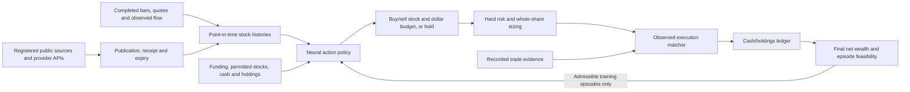

# Architecture

StockTrade separates information ingestion, direct neural actions, hard risk constraints, observed execution evidence and a single episode-level wealth objective. The workflow is long-only, supports multiple US equities in USD and submits no broker orders.

## Time and information boundaries

A bar timestamp is its timezone-aware end. Its OHLCV becomes available at that end; incomplete bars are not input. Histories for all checkpoint stocks require matching decision timestamps. Missing intervals are rejected rather than padded with future observations.

Events retain publication, actual availability and optional expiry. Both publication and availability must have passed before a feature consumes an event. Current collectors require source publication timestamps: undated RSS items are skipped, and HTML/JSON sources with unknown publication time report failure. Expiry starts at source publication, not fetch time. Expired observations become missing; recollecting unchanged content cannot renew its source age. Publication/receipt archives are required for historical experiments. Current websites cannot be scraped and backdated into training.

Online `act` refreshes bounded registered sources by default. Only the final feature clock may advance to the current decision time, allowing newly received information alongside the latest completed bar. The original market timestamp stays separate: no fake price/volume observation is generated. Online mode rejects future bars and market observations older than the configured age limit, 900 seconds by default. `--offline` uses the supplied historical clocks/events without collection. Training and historical evaluation never collect current web information for a past decision.

Feature masks distinguish absent values from real zeros. Feature definitions and scaling come from the training prefix. Canonical platform fields are registered in advance; their normal neural encoder learns importance without a manually elevated weight. Fields never observed in training remain masked until retraining. Unknown future-only keys cannot enter the frozen checkpoint schema.

The chronological default split is 70% training, 15% validation and 15% held-out timestamps. Training uses equal-sized bounded episodes, default 128 bars, starting from fresh funded accounts. If the training prefix is shorter, the configured count is reduced to its available window; a remaining short tail is excluded rather than treated as an easier shorter episode. Validation and evaluation each use their own later period with frozen parameters. The last bar is a valuation observation only because an order arriving afterward would lack within-episode execution evidence.

Checkpoint metadata identifies feature schemas, stock universe, preprocessing, risk configuration and original history. Action inference requires observations strictly after the saved training/validation cutoff, including offline calls. Runtime permissions may restrict trading to a subset of trained stocks; their other trained stocks still supply account/market context and holding marks. Positive holdings outside the trained universe are rejected. Earlier forecast/action-reward checkpoints require retraining in format 3, `direct_wealth_policy`.

## Direct trainable policy

Per-stock modality encoders consume observed values and masks. A shared GRU processes each historical window, default 16 bars. Inventory and account encoders add funding, cash, holdings and loss state. Cross-stock attention compares the universe. The categorical action head emits hold or a stock, buy/sell side and budget bin: 1%, 5%, 10% or 20% of initial funding by default.

The output is a direct trading intention, not a forecast or target holdings fraction. There are no price, reconstructed-input or critic prediction heads. All encoders and action parameters learn together from portfolio outcomes.

For one stochastic episode, REINFORCE updates the trajectory's action log probabilities from **one shared terminal wealth-growth scalar**. A running mean of earlier episode returns reduces gradient variance; it does not define a counterfactual trade or change measured financial wealth. Default entropy weight is zero so net wealth remains the sole objective. Gradient clipping limits unstable updates.

There is no independent trade-grade evaluator, avoided-loss bonus, downside weighting or sum of invented counterfactual rewards. Future prices only value the evolving account and its final holdings. The objective is `final_equity / initial_funding − 1`; recorded execution fees already reduced ledger cash and are not charged again. Existing positions remain marked at the endpoint rather than receiving an assumed liquidation.

## Risk and admissibility

Risk is enforced as constraints, not a weighted subtraction from wealth. Action checks bound whole-share size by cash, owned shares, concentration, gross exposure, observed volume and turnover. Buys budget against the ask, sells against the bid; unsupported share quantities are never manufactured. A budget below one share produces no order. Known account/quote information is used, with no forecast dependency.

Defaults cap one stock at 20% of equity, gross exposure at 60%, interval participation at 1% of observed volume and proposal turnover at 10%, while retaining 20% cash. Spread/data-quality gates reject unsuitable intentions. A 15% drawdown or 3% daily loss blocks further buying while permitting supported risk reduction. `--risk-config` accepts explicit JSON limit overrides for training; the saved configuration accompanies evaluation.

Current `act` calls for an existing account need actual historical peak and day-start equity through `--peak-equity` and `--day-start-equity`. With explicit cash or any owned shares, missing either baseline blocks new buys with `risk_history_missing`; chosen holds and risk-checked sales remain available. A modeled fresh account without explicit cash or nonzero holdings infers both baselines from initial funding. It does not reset an existing account's loss history to its current value.

Episode checks separately measure drawdown, daily loss, gross exposure and minimum cash from complete account observations. Daily boundaries use the US market timezone, `America/New_York`. A gap can breach a limit even if every proposed action passed its checks. Risk-rejected proposals are known no-order transitions, not fabricated losses. Episodes with observed violations or incomplete submitted-intent execution evidence are reported and excluded from policy updates and checkpoint selection. Their actual wealth outcome is still recorded; it is not replaced by an arbitrary negative score.

Validation selects highest terminal wealth growth among admissible episodes over the same fixed validation period. No drawdown coefficient or per-action reward sum ranks checkpoints. Held-out evaluation never updates parameters or selects a checkpoint. These controls cover selected measurable risks, not every operational or market loss mechanism.

## Execution and conditional wealth

After a latency-adjusted arrival, the matcher searches a bounded subsequent interval for compatible symbol, side, limit price, exact quantity and quote/regime context. Aggressive actions require the recorded aggressor side; passive matches additionally need attributed queue progression. It chooses the earliest compatible event without seeing subsequent profitability. Source IDs cannot justify multiple executions.

The CLI requires exact quantity. The lower-level matching API can allow a smaller near-size analog and retains its actual quantity. No compatible event means abstention and an unchanged account, not a close-price fill. Reports retain unsupported intentions, source IDs and coverage. Incomplete evidence makes an episode ineligible to teach terminal wealth as though its intended strategy were observed.

The ledger is conditional on historical analogs. It cannot reveal where an added order would enter the queue, which orders it would displace or how other traders would respond. Causal market impact requires a separate structural model and sufficient order lifecycle evidence.

## Source and extension contracts

Automatic collection supports explicitly registered public HTTPS RSS/HTML and configured JSON APIs with bounded response sizes, refresh intervals, expiry and deduplication. Authentication uses environment-backed headers. Source failures are reported; provider text is data, never executable instructions.

The Alpaca adapter is read-only: raw one-minute bars are converted from interval-open to interval-end timestamps, and downloaded news receives actual retrieval availability. Bars do not supply aggressor side, execution IDs or queue evidence. Archive corrections and genuine historical receipt times remain limitations.

Add providers through the normalized timing contract; expand architectures behind account/action and checkpoint interfaces. LEAN or other simulation engines must delegate fills to this project's matcher. A live broker integration, strategic market-agent simulator, operational monitoring and reconciliation require separate designs.
